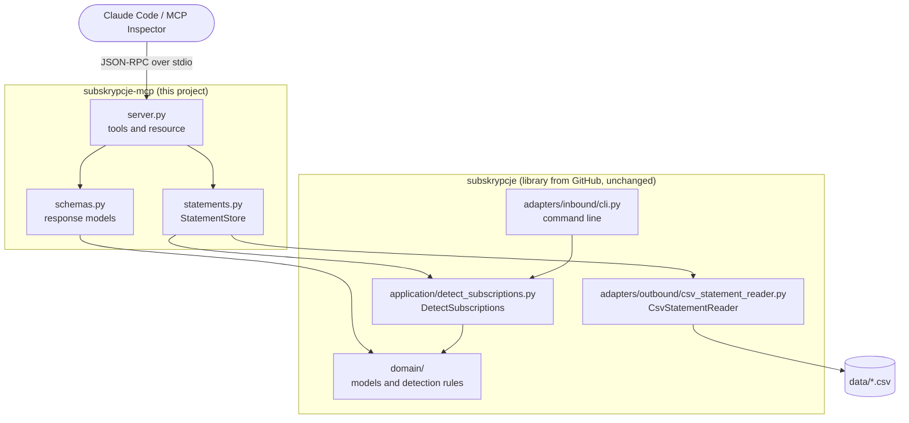

[Polski](README.md) · **English**

---

> ### 🎥 YouTube video
> This repository comes with a video in which I walk through the code, the architectural assumptions and the design decisions step by step.
> If you prefer watching to reading, start with the video and treat this README as supplementary material.
>
> 👉 **[Watch the video on YouTube](https://youtu.be/FofSb7QFL8w)**

---

# subskrypcje-mcp

An MCP server through which Claude Code asks about subscriptions detected in a CSV bank statement.

The `subskrypcje` application from the previous video has a single interface. You run it in the terminal and get the report as a text table. You have to read every answer from that table yourself. You cannot ask, for example, what got more expensive or what to cancel to save 50 PLN. This project adds a second interface, an MCP server. Through it Claude Code queries the data directly and gets the result in a fixed JSON format. Not a single line of the application code changes. The server is a separate project that uses the application as a library. In hexagonal architecture it is simply a new inbound adapter next to the command line.

The repository contains two projects:

| Folder | Contents |
| --- | --- |
| `skill-pro/` | The `subskrypcje` application from the previous video: CLI, the `SPEC.md` specification, the `python-hex-projekt` skill and tests |
| `subskrypcje-mcp/` | The MCP server covered in this video |

## Table of contents

- [What this project shows](#what-this-project-shows)
- [Architecture](#architecture)
- [Directory structure](#directory-structure)
- [Requirements](#requirements)
- [Installation](#installation)
- [Configuration](#configuration)
- [Running](#running)
- [Connecting to Claude Code](#connecting-to-claude-code)
- [Tools and resource](#tools-and-resource)
- [Safe file access](#safe-file-access)
- [Base application skill-pro](#base-application-skill-pro)
- [Code quality](#code-quality)

## What this project shows

- **A new adapter without touching the application** - the MCP server sits next to the CLI and uses the same `DetectSubscriptions` use case. The `subskrypcje` package stays untouched.
- **An earlier project as a library** - `uv add` installs the application from the `skill-pro` subdirectory of a GitHub repository, just like any other dependency.
- **Two tools and one resource** - `monthly_subscription_cost`, `price_increases` and the `subskrypcje://raport` resource.
- **Responses in a fixed format** - the tools return Pydantic models, so the client gets JSON as structured output.
- **Read-only server** - the tools carry the `read_only_hint=True` annotation, and `StatementStore` has no write method at all.
- **File access control** - an allow-list of characters in the file name, a directory check after `resolve()` and a file size limit.
- **Descriptions for the model** - docstrings and field descriptions from `Field` end up in the tool descriptions. Claude Code picks the tool on its own based on them.
- **Testing and configuration** - checking the server in MCP Inspector and configuring Claude Code with the `project` scope, stored in `.mcp.json`.

## Architecture



| Element | File | Responsibility |
| --- | --- | --- |
| MCP adapter | `subskrypcje-mcp/src/subskrypcje_mcp/server.py` | Defines the tools and the resource, turns access errors into `ToolError`, starts the server |
| Response schemas | `subskrypcje-mcp/src/subskrypcje_mcp/schemas.py` | Pydantic models built from domain objects via `from_domain` |
| Statement access | `subskrypcje-mcp/src/subskrypcje_mcp/statements.py` | `StatementStore`: file name validation, wiring `DetectSubscriptions` with `CsvStatementReader` |
| `subskrypcje` application | package from GitHub | Reading the CSV, subscription detection rules, report |

The dependency points one way only. `subskrypcje_mcp` imports `subskrypcje`, and the application knows nothing about MCP. In the server, `StatementStore` plays the role that `main.py` plays in the CLI. Its constructor wires `DetectSubscriptions` with the `CsvStatementReader` adapter.

## Directory structure

```
subscriptions-spec-and-skill-mcp/
├── skill-pro/                                  # application from the previous video (CLI)
│   ├── CLAUDE.md                               # project rules summary for Claude Code
│   ├── SPEC.md                                 # application specification
│   ├── README.md
│   ├── pyproject.toml
│   ├── data/
│   │   └── wyciag-przyklad.csv                 # sample statement
│   ├── skill/
│   │   └── python-hex-projekt/
│   │       └── SKILL.md                        # skill: standard for a new Python project
│   ├── src/subskrypcje/
│   │   ├── main.py                             # composition root
│   │   ├── logging_config.py                   # structlog configuration
│   │   ├── domain/                             # models.py, detection.py
│   │   ├── application/                        # ports.py, errors.py, detect_subscriptions.py
│   │   └── adapters/
│   │       ├── inbound/cli.py                  # argparse and report on stdout
│   │       └── outbound/csv_statement_reader.py
│   ├── teoria/
│   │   ├── 1-uruchomienie-aplikacji.txt
│   │   └── 2-mcp-teoria.txt
│   └── tests/
│       ├── conftest.py
│       ├── test_architecture.py
│       ├── unit/
│       ├── integration/
│       └── e2e/
└── subskrypcje-mcp/                            # MCP server from this video
    ├── .mcp.json                               # server configuration for Claude Code
    ├── pyproject.toml
    ├── data/
    │   └── wyciag-przyklad.csv
    ├── src/subskrypcje_mcp/
    │   ├── __init__.py                         # exports main
    │   ├── server.py                           # tools, resource, main()
    │   ├── schemas.py                          # response models (Pydantic)
    │   └── statements.py                       # StatementStore and StatementAccessError
    └── teoria/
        └── 1-konfiguracja.txt                  # commands from the video
```

## Requirements

- Python **3.14** or newer
- [uv](https://docs.astral.sh/uv/) for dependency management
- git, because uv fetches the `subskrypcje` package from a GitHub repository
- Node.js with `npx`, only for running MCP Inspector
- Claude Code, to talk to the server

## Installation

```bash
git clone https://github.com/kmprograms/subscriptions-spec-and-skill-mcp
cd subscriptions-spec-and-skill-mcp/subskrypcje-mcp
uv sync
```

`uv sync` creates the virtual environment and installs the dependencies. uv fetches the `subskrypcje` package from GitHub, as declared in `pyproject.toml`:

```toml
[tool.uv.sources]
subskrypcje = { git = "https://github.com/kmprograms/subscriptions-spec-and-skill", subdirectory = "skill-pro" }
```

So the server does not use the `skill-pro/` folder from this repository. The dependency points to the `subscriptions-spec-and-skill` repository.

### Project from scratch

This is how the `subskrypcje-mcp` project was created (commands from `teoria/1-konfiguracja.txt`):

```bash
uv init --package --python 3.14 subskrypcje-mcp
cd subskrypcje-mcp
uv add mcp
uv add "subskrypcje @ git+https://github.com/kmprograms/subscriptions-spec-and-skill#subdirectory=skill-pro"
uv add --dev ruff pytest
```

The first `uv add` installs the official MCP SDK for Python. The second installs the application from the previous video as a library. The third adds Ruff and pytest as development dependencies.

## Configuration

| Variable | Default | Description |
| --- | --- | --- |
| `SUBSKRYPCJE_DATA_DIR` | `data` | Directory with CSV statements. A relative path is resolved against the current directory. The directory must exist, because `resolve(strict=True)` stops the server right at startup rather than on the first question. |
| `PYTHONUTF8` | none, set to `1` in `.mcp.json` | Enables Python's UTF-8 mode, so Polish characters in logs are displayed correctly. The protocol itself transmits data in UTF-8 anyway. |

Constants in the code:

| Constant | File | Value | Meaning |
| --- | --- | --- | --- |
| `DEFAULT_STATEMENT` | `server.py` | `"wyciag-przyklad.csv"` | Statement used when a tool gets no file name. The resource is built from it as well. |
| `MAX_STATEMENT_BYTES` | `statements.py` | `5 * 1024 * 1024` | Maximum statement size, i.e. 5 MB. The server will not load a larger file. |
| `STATEMENT_NAME` | `statements.py` | `re.compile(r"[A-Za-z0-9_-]{1,64}\.csv")` | Allowed shape of the file name |

The sample statement is located at `data/wyciag-przyklad.csv`.

## Running

### Server in the terminal

```bash
uv run subskrypcje-mcp
```

The server prints nothing. It waits for JSON-RPC messages on standard input, because it runs on the stdio transport. Stop it with Ctrl+C. This is a quick check that the server starts at all.

`main()` calls `configure_logging("INFO", "json")` from the `subskrypcje` application. Logs go to stderr in JSON format, so they do not mix with protocol messages on stdout.

### MCP Inspector

```bash
npx @modelcontextprotocol/inspector uv run subskrypcje-mcp
```

Inspector opens a browser window. After connecting, the status changes from Disconnected to Connected. The Tools tab shows both tools with their descriptions from the docstrings and the read only flag set to true. The Resources tab shows the report resource.

In the video I check in Inspector that:

- `monthly_subscription_cost` for `wyciag-przyklad.csv` returns the summary as JSON and as structured output,
- `price_increases` with `min_increase_percent` set to 50 returns an empty list, and with 5 it returns one subscription,
- the `report` resource returns the full report, i.e. the same data the CLI shows.

## Connecting to Claude Code

The `.mcp.json` file is already in the repository. It was created with this command:

```bash
claude mcp add subskrypcje --scope project -e PYTHONUTF8=1 -- uv run subskrypcje-mcp
```

```json
{
  "mcpServers": {
    "subskrypcje": {
      "type": "stdio",
      "command": "uv",
      "args": [
        "run",
        "subskrypcje-mcp"
      ],
      "env": {
        "PYTHONUTF8": "1"
      }
    }
  }
}
```

The `project` scope stores the configuration in `.mcp.json` in the project directory. Anyone who clones the repository gets the server right away. There are also the `local` scope, only for you in this project, and the `user` scope, across all your projects.

Check the server status with:

```bash
claude mcp list
```

A server from the project file waits for your approval (pending approval). Claude Code will not start it without asking. Otherwise, simply cloning a repository could run an arbitrary command on your machine. When you run `claude` in the `subskrypcje-mcp` directory, you will see the message "New MCP server found in this project". Choose "Use this MCP server".

Questions I ask in the video (asked in Polish, translated here):

- "How much do I spend on subscriptions per month?" - Claude Code picks `monthly_subscription_cost` on its own, based on the docstring. Answer: 219.98 PLN per month, four subscriptions, CityFit being the most expensive.
- "Which subscriptions got more expensive and how much does it cost me per year?" - only Spotify went up, which adds 36 PLN per year.
- "What can I cancel to save at least 50 PLN per month?" - Claude Code lays out cancellation options based on the cost of each subscription.

## Tools and resource

| Element | Kind | Parameters | Returns |
| --- | --- | --- | --- |
| `monthly_subscription_cost` | tool | `statement` (default `wyciag-przyklad.csv`) | `SpendingSummary`: total subscription spending per month and per year, plus the cost of each subscription |
| `price_increases` | tool | `statement`, `min_increase_percent` (0 to 100, default 0) | `PriceIncreases`: subscriptions whose price went up by at least the given threshold |
| `subskrypcje://raport` | resource, `application/json` | none | Full `SpendingSummary` report for the default statement as JSON |

Both tools carry the annotation `READ_ONLY = ToolAnnotations(read_only_hint=True, open_world_hint=False)`. The docstring is the tool description the model sees, so it is worth taking care of:

```python
    @mcp.tool(annotations=READ_ONLY)
    def monthly_subscription_cost(statement: StatementName = DEFAULT_STATEMENT) -> SpendingSummary:
        """Zwraca sumę wydatków na subskrypcje w miesiącu i w roku oraz koszt każdej subskrypcji.

        Użyj, gdy użytkownik pyta, ile wydaje na subskrypcje.
        """
        return SpendingSummary.from_domain(statement, load_report(statement))
```

Response models from `schemas.py`. Amounts are of type `Decimal`:

| Model | Fields |
| --- | --- |
| `SubscriptionCost` | `name`, `monthly_cost`, `yearly_cost` |
| `SpendingSummary` | `statement`, `currency` (default `"PLN"`), `subscription_count`, `monthly_total`, `yearly_total`, `subscriptions: list[SubscriptionCost]` |
| `PriceIncrease` | `name`, `old_price`, `new_price`, `increase`, `increase_percent` (rounded to one decimal place), `extra_yearly_cost` (`increase * 12`) |
| `PriceIncreases` | `statement`, `currency` (default `"PLN"`), `min_increase_percent`, `subscriptions: list[PriceIncrease]` |

`price_increases` takes only subscriptions where `latest_amount > earliest_amount`, then keeps those with `increase_percent >= min_increase_percent`.

## Safe file access

The first check is done by the argument schema. The `StatementName` type has the file name pattern defined in `Field`:

```python
StatementName = Annotated[
    str,
    Field(
        description="Nazwa pliku CSV z katalogu danych, bez ścieżki, np. wyciag-przyklad.csv.",
        pattern=r"^[A-Za-z0-9_-]{1,64}\.csv$",
    ),
]
```

The second check is done by `StatementStore._resolve`:

```python
    def _resolve(self, name: str) -> Path:
        if not STATEMENT_NAME.fullmatch(name):
            raise StatementAccessError("Nazwa wyciagu musi mieć postać nazwa.csv, bez ścieżki")

        path = (self._data_dir / name).resolve()
        if not path.is_relative_to(self._data_dir):
            raise StatementAccessError("Wyciąg musi leżeć w katalogu danych")
        if not path.is_file():
            available = ", ".join(self.names()) or "brak"
            raise StatementAccessError(f"Nie ma wyciągu {name}. Dostępne: {available}")
        if path.stat().st_size > MAX_STATEMENT_BYTES:
            raise StatementAccessError("Plik wyciągu jest za duży")
        return path
```

| Step | Check | What it blocks |
| --- | --- | --- |
| 1 | `STATEMENT_NAME.fullmatch(name)` | Slashes, dots inside the name, drive letters and extensions other than `.csv` |
| 2 | `path.is_relative_to(self._data_dir)` after `resolve()` | Escaping the data directory |
| 3 | `path.is_file()` | A missing file. The message lists the available statements. |
| 4 | `path.stat().st_size > MAX_STATEMENT_BYTES` | Files larger than 5 MB |

`load_report` in `server.py` turns `StatementAccessError` into `ToolError`, so the model receives an error message with the exception text. `StatementStore` has no write method at all. The server is read-only at the code level. Because the application is separated from the server, it is the developer who decides in the MCP layer what the AI agent is allowed to do.

In the video I test this with an attack attempt. A request to count subscriptions from a file outside the allowed pattern ends with the server rejecting the request.

## Base application skill-pro

The `skill-pro/` folder contains the `subskrypcje` application from the previous video. The program reads a bank statement in CSV, detects subscriptions and shows their monthly and yearly cost. The code was generated with AI from the `SPEC.md` specification and the `skill/python-hex-projekt/SKILL.md` skill. The skill describes the company project standard: uv, hexagonal architecture, structlog, pytest and Ruff.

A group of expenses for one counterparty is a subscription when it has at least 3 payments, the gaps between them are 25 to 35 days, and every amount is within ±20% of the median. The full rules R1-R7 and the acceptance criteria are in `SPEC.md`.

```bash
cd subscriptions-spec-and-skill-mcp/skill-pro
uv sync
uv run subskrypcje data/wyciag-przyklad.csv
uv run subskrypcje data/wyciag-przyklad.csv --log-format json --log-level WARNING
```

The report goes to stdout, logs go to stderr. In PowerShell you can hide the logs like this:

```powershell
uv run subskrypcje data/wyciag-przyklad.csv 2>$null
```

Output for the sample statement:

```
Wykryte subskrypcje: 4
CITYFIT SP. Z O.O.     139,00 zł/mies.   1668,00 zł/rok
NETFLIX.COM             49,00 zł/mies.    588,00 zł/rok
SPOTIFY AB STOCKHOLM    26,99 zł/mies.    323,88 zł/rok   zmiana ceny: 23,99 -> 26,99
APPLE.COM/BILL           4,99 zł/mies.     59,88 zł/rok
Razem: 219,98 zł/mies., 2639,76 zł/rok
```

## Code quality

MCP server (`subskrypcje-mcp/`):

```bash
uv run ruff format .
uv run ruff check .
```

Ruff enables the `E`, `W`, `F`, `I`, `UP`, `B`, `SIM`, `PTH`, `RUF`, `S`, `ASYNC` rule sets with a line length of 100 characters. Compared to the base application, `S` (common security issues) and `ASYNC` (correctness of async code) were added. Rule `S101` is disabled for `tests/**`. `pyproject.toml` already contains the pytest configuration, but the server project does not have a `tests/` directory yet.

Base application (`skill-pro/`):

```bash
uv run pytest
uv run ruff format .
uv run ruff check .
```

The tests are split into `unit/` (domain and use case with an in-memory fake adapter), `integration/` (CSV adapter on real files in `tmp_path`) and `e2e/` (the whole application via `main(argv)`). `test_architecture.py` parses imports with `ast` and enforces the dependency direction adapters -> application -> domain.