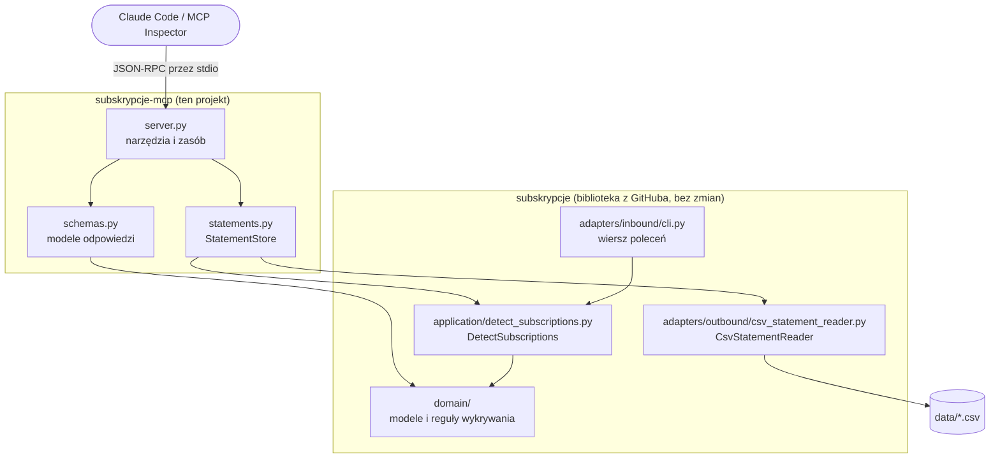

**Polski** · [English](README.en.md)

---

> ### 🎥 Nagranie na YouTube
> Do tego repozytorium powstało nagranie wideo, w którym krok po kroku omawiam kod, założenia architektoniczne i decyzje projektowe.
> Jeśli wolisz obejrzeć zamiast czytać, zacznij od filmu, a README traktuj jako materiał uzupełniający.
>
> 👉 **[Obejrzyj nagranie na YouTube](https://youtu.be/FofSb7QFL8w)**

---

# subskrypcje-mcp

Serwer MCP, przez który Claude Code pyta o subskrypcje wykryte na wyciągu bankowym w CSV.

Aplikacja `subskrypcje` z poprzedniego nagrania ma jeden interfejs. Uruchamiasz ją w terminalu, a raport dostajesz jako tekstową tabelę. Każdą odpowiedź musisz wyczytać z tej tabeli sam. Nie zapytasz na przykład, co podrożało albo co wyłączyć, żeby oszczędzić 50 zł. Ten projekt dodaje drugi interfejs, czyli serwer MCP. Przez niego Claude Code pyta o dane bezpośrednio i dostaje wynik w ustalonym formacie JSON. Kod aplikacji nie zmienia się ani o linię. Serwer jest osobnym projektem, który używa aplikacji jak biblioteki. W architekturze heksagonalnej to po prostu nowy adapter wejściowy obok wiersza poleceń.

Repozytorium zawiera dwa projekty:

| Folder | Zawartość |
| --- | --- |
| `skill-pro/` | Aplikacja `subskrypcje` z poprzedniego nagrania: CLI, specyfikacja `SPEC.md`, skill `python-hex-projekt` i testy |
| `subskrypcje-mcp/` | Serwer MCP omawiany w tym nagraniu |

## Spis treści

- [Co pokazuje ten projekt](#co-pokazuje-ten-projekt)
- [Architektura](#architektura)
- [Struktura katalogów](#struktura-katalogów)
- [Wymagania](#wymagania)
- [Instalacja](#instalacja)
- [Konfiguracja](#konfiguracja)
- [Uruchomienie](#uruchomienie)
- [Podłączenie do Claude Code](#podłączenie-do-claude-code)
- [Narzędzia i zasób](#narzędzia-i-zasób)
- [Bezpieczny dostęp do plików](#bezpieczny-dostęp-do-plików)
- [Aplikacja bazowa skill-pro](#aplikacja-bazowa-skill-pro)
- [Jakość kodu](#jakość-kodu)

## Co pokazuje ten projekt

- **Nowy adapter bez zmian w aplikacji** - serwer MCP stoi obok CLI i korzysta z tego samego przypadku użycia `DetectSubscriptions`. Pakiet `subskrypcje` pozostaje nietknięty.
- **Wcześniejszy projekt jako biblioteka** - `uv add` instaluje aplikację z podkatalogu `skill-pro` repozytorium na GitHubie, tak jak każdą inną zależność.
- **Dwa narzędzia i jeden zasób** - `monthly_subscription_cost`, `price_increases` oraz zasób `subskrypcje://raport`.
- **Odpowiedzi w ustalonym formacie** - narzędzia zwracają modele Pydantic, więc klient dostaje JSON jako structured output.
- **Serwer tylko do odczytu** - narzędzia mają adnotację `read_only_hint=True`, a `StatementStore` nie ma żadnej metody zapisu.
- **Kontrola dostępu do plików** - lista dozwolonych znaków w nazwie, sprawdzenie katalogu po `resolve()` i limit rozmiaru pliku.
- **Opisy dla modelu** - docstringi i opisy pól z `Field` trafiają do opisu narzędzi. Na ich podstawie Claude Code sam wybiera narzędzie.
- **Testowanie i konfiguracja** - sprawdzenie serwera w MCP Inspector i konfiguracja Claude Code w zakresie `project`, zapisana w `.mcp.json`.

## Architektura



| Element | Plik | Odpowiedzialność |
| --- | --- | --- |
| Adapter MCP | `subskrypcje-mcp/src/subskrypcje_mcp/server.py` | Definicja narzędzi i zasobu, zamiana błędów dostępu na `ToolError`, start serwera |
| Schematy odpowiedzi | `subskrypcje-mcp/src/subskrypcje_mcp/schemas.py` | Modele Pydantic budowane z obiektów domeny przez `from_domain` |
| Dostęp do wyciągów | `subskrypcje-mcp/src/subskrypcje_mcp/statements.py` | `StatementStore`: walidacja nazwy pliku, złożenie `DetectSubscriptions` z `CsvStatementReader` |
| Aplikacja `subskrypcje` | pakiet z GitHuba | Wczytanie CSV, reguły wykrywania subskrypcji, raport |

Zależność biegnie tylko w jedną stronę. `subskrypcje_mcp` importuje `subskrypcje`, a aplikacja nic nie wie o MCP. `StatementStore` pełni w serwerze tę rolę, którą w CLI ma `main.py`. W konstruktorze składa `DetectSubscriptions` z adapterem `CsvStatementReader`.

## Struktura katalogów

```
subscriptions-spec-and-skill-mcp/
├── skill-pro/                                  # aplikacja z poprzedniego nagrania (CLI)
│   ├── CLAUDE.md                               # skrót zasad projektu dla Claude Code
│   ├── SPEC.md                                 # specyfikacja aplikacji
│   ├── README.md
│   ├── pyproject.toml
│   ├── data/
│   │   └── wyciag-przyklad.csv                 # przykładowy wyciąg
│   ├── skill/
│   │   └── python-hex-projekt/
│   │       └── SKILL.md                        # skill: standard nowego projektu w Pythonie
│   ├── src/subskrypcje/
│   │   ├── main.py                             # composition root
│   │   ├── logging_config.py                   # konfiguracja structlog
│   │   ├── domain/                             # models.py, detection.py
│   │   ├── application/                        # ports.py, errors.py, detect_subscriptions.py
│   │   └── adapters/
│   │       ├── inbound/cli.py                  # argparse i raport na stdout
│   │       └── outbound/csv_statement_reader.py
│   ├── teoria/
│   │   ├── 1-uruchomienie-aplikacji.txt
│   │   └── 2-mcp-teoria.txt
│   └── tests/
│       ├── conftest.py
│       ├── test_architecture.py
│       ├── unit/
│       ├── integration/
│       └── e2e/
└── subskrypcje-mcp/                            # serwer MCP z tego nagrania
    ├── .mcp.json                               # konfiguracja serwera dla Claude Code
    ├── pyproject.toml
    ├── data/
    │   └── wyciag-przyklad.csv
    ├── src/subskrypcje_mcp/
    │   ├── __init__.py                         # eksport main
    │   ├── server.py                           # narzędzia, zasób, main()
    │   ├── schemas.py                          # modele odpowiedzi (Pydantic)
    │   └── statements.py                       # StatementStore i StatementAccessError
    └── teoria/
        └── 1-konfiguracja.txt                  # komendy z nagrania
```

## Wymagania

- Python **3.14** lub nowszy
- [uv](https://docs.astral.sh/uv/) do zarządzania zależnościami
- git, bo uv pobiera pakiet `subskrypcje` z repozytorium na GitHubie
- Node.js z `npx`, tylko do uruchomienia MCP Inspector
- Claude Code, żeby rozmawiać z serwerem

## Instalacja

```bash
git clone https://github.com/kmprograms/subscriptions-spec-and-skill-mcp
cd subscriptions-spec-and-skill-mcp/subskrypcje-mcp
uv sync
```

`uv sync` tworzy wirtualne środowisko i instaluje zależności. Pakiet `subskrypcje` uv pobiera z GitHuba, zgodnie z wpisem w `pyproject.toml`:

```toml
[tool.uv.sources]
subskrypcje = { git = "https://github.com/kmprograms/subscriptions-spec-and-skill", subdirectory = "skill-pro" }
```

Serwer nie korzysta więc z folderu `skill-pro/` z tego repozytorium. Zależność wskazuje na repozytorium `subscriptions-spec-and-skill`.

### Projekt od zera

Tak powstał projekt `subskrypcje-mcp` (komendy z pliku `teoria/1-konfiguracja.txt`):

```bash
uv init --package --python 3.14 subskrypcje-mcp
cd subskrypcje-mcp
uv add mcp
uv add "subskrypcje @ git+https://github.com/kmprograms/subscriptions-spec-and-skill#subdirectory=skill-pro"
uv add --dev ruff pytest
```

Pierwsze `uv add` instaluje oficjalne SDK MCP dla Pythona. Drugie instaluje aplikację z poprzedniego nagrania jako bibliotekę. Trzecie dodaje Ruff i pytest jako zależności deweloperskie.

## Konfiguracja

| Zmienna | Domyślnie | Opis |
| --- | --- | --- |
| `SUBSKRYPCJE_DATA_DIR` | `data` | Katalog z wyciągami CSV. Ścieżka względna liczy się od bieżącego katalogu. Katalog musi istnieć, bo `resolve(strict=True)` zatrzyma serwer już przy starcie, a nie dopiero przy pierwszym pytaniu. |
| `PYTHONUTF8` | brak, w `.mcp.json` ustawiona na `1` | Włącza tryb UTF-8 w Pythonie, dzięki czemu polskie znaki w logach są wyświetlane poprawnie. Sam protokół i tak przesyła dane w UTF-8. |

Stałe w kodzie:

| Stała | Plik | Wartość | Znaczenie |
| --- | --- | --- | --- |
| `DEFAULT_STATEMENT` | `server.py` | `"wyciag-przyklad.csv"` | Wyciąg używany, gdy narzędzie nie dostanie nazwy pliku. Z niego powstaje też zasób. |
| `MAX_STATEMENT_BYTES` | `statements.py` | `5 * 1024 * 1024` | Maksymalny rozmiar wyciągu, czyli 5 MB. Serwer nie wczyta większego pliku. |
| `STATEMENT_NAME` | `statements.py` | `re.compile(r"[A-Za-z0-9_-]{1,64}\.csv")` | Dozwolona postać nazwy pliku |

Przykładowy wyciąg leży w `data/wyciag-przyklad.csv`.

## Uruchomienie

### Serwer w terminalu

```bash
uv run subskrypcje-mcp
```

Serwer nic nie wypisuje. Czeka na wiadomości JSON-RPC na standardowym wejściu, bo działa na transporcie stdio. Zatrzymasz go przez Ctrl+C. To szybki test, czy serwer w ogóle wstaje.

`main()` wywołuje `configure_logging("INFO", "json")` z aplikacji `subskrypcje`. Logi trafiają w formacie JSON na stderr, więc nie mieszają się z wiadomościami protokołu na stdout.

### MCP Inspector

```bash
npx @modelcontextprotocol/inspector uv run subskrypcje-mcp
```

Inspector otwiera okno w przeglądarce. Po połączeniu status zmienia się z Disconnected na Connected. W zakładce Tools widać oba narzędzia z opisami z docstringów i flagą read only ustawioną na true. W zakładce Resources jest zasób z raportem.

W nagraniu sprawdzam w Inspectorze:

- `monthly_subscription_cost` dla `wyciag-przyklad.csv` zwraca podsumowanie jako JSON i structured output,
- `price_increases` z `min_increase_percent` równym 50 zwraca pustą listę, a z wartością 5 zwraca jedną subskrypcję,
- zasób `report` zwraca cały raport, czyli te same dane, które pokazuje CLI.

## Podłączenie do Claude Code

Plik `.mcp.json` jest już w repozytorium. Powstał tą komendą:

```bash
claude mcp add subskrypcje --scope project -e PYTHONUTF8=1 -- uv run subskrypcje-mcp
```

```json
{
  "mcpServers": {
    "subskrypcje": {
      "type": "stdio",
      "command": "uv",
      "args": [
        "run",
        "subskrypcje-mcp"
      ],
      "env": {
        "PYTHONUTF8": "1"
      }
    }
  }
}
```

Zakres `project` zapisuje konfigurację w `.mcp.json` w katalogu projektu. Każdy, kto sklonuje repozytorium, dostaje serwer od razu. Są jeszcze zakresy `local`, czyli tylko dla Ciebie w tym projekcie, oraz `user`, czyli we wszystkich Twoich projektach.

Stan serwera sprawdzisz komendą:

```bash
claude mcp list
```

Serwer z pliku projektu czeka na Twoją zgodę (pending approval). Claude Code nie uruchomi go bez pytania. Gdyby tak było, samo sklonowanie repozytorium mogłoby uruchomić dowolną komendę na Twoim komputerze. Po uruchomieniu `claude` w katalogu `subskrypcje-mcp` pojawi się komunikat "New MCP server found in this project". Wybierz "Use this MCP server".

Pytania, które zadaję w nagraniu:

- "Ile wydaję miesięcznie na subskrypcje?" - Claude Code sam wybiera `monthly_subscription_cost` na podstawie opisu z docstringa. Odpowiedź: 219,98 zł miesięcznie, cztery subskrypcje, najwięcej kosztuje CityFit.
- "Które subskrypcje podrożały i ile mnie to kosztuje rocznie?" - podrożał tylko Spotify, co daje 36 zł więcej rocznie.
- "Co mogę wyłączyć, żeby zaoszczędzić co najmniej 50 złotych miesięcznie?" - Claude Code zestawia warianty rezygnacji na podstawie kosztów poszczególnych subskrypcji.

## Narzędzia i zasób

| Element | Rodzaj | Parametry | Zwraca |
| --- | --- | --- | --- |
| `monthly_subscription_cost` | narzędzie | `statement` (domyślnie `wyciag-przyklad.csv`) | `SpendingSummary`: sumę wydatków na subskrypcje w miesiącu i w roku oraz koszt każdej subskrypcji |
| `price_increases` | narzędzie | `statement`, `min_increase_percent` (od 0 do 100, domyślnie 0) | `PriceIncreases`: subskrypcje, które podrożały co najmniej o podany próg |
| `subskrypcje://raport` | zasób, `application/json` | brak | Pełny raport `SpendingSummary` z domyślnego wyciągu jako JSON |

Oba narzędzia mają adnotację `READ_ONLY = ToolAnnotations(read_only_hint=True, open_world_hint=False)`. Docstring jest opisem narzędzia, który widzi model, więc warto o niego dbać:

```python
    @mcp.tool(annotations=READ_ONLY)
    def monthly_subscription_cost(statement: StatementName = DEFAULT_STATEMENT) -> SpendingSummary:
        """Zwraca sumę wydatków na subskrypcje w miesiącu i w roku oraz koszt każdej subskrypcji.

        Użyj, gdy użytkownik pyta, ile wydaje na subskrypcje.
        """
        return SpendingSummary.from_domain(statement, load_report(statement))
```

Modele odpowiedzi z `schemas.py`. Kwoty mają typ `Decimal`:

| Model | Pola |
| --- | --- |
| `SubscriptionCost` | `name`, `monthly_cost`, `yearly_cost` |
| `SpendingSummary` | `statement`, `currency` (domyślnie `"PLN"`), `subscription_count`, `monthly_total`, `yearly_total`, `subscriptions: list[SubscriptionCost]` |
| `PriceIncrease` | `name`, `old_price`, `new_price`, `increase`, `increase_percent` (zaokrąglony do jednego miejsca po przecinku), `extra_yearly_cost` (`increase * 12`) |
| `PriceIncreases` | `statement`, `currency` (domyślnie `"PLN"`), `min_increase_percent`, `subscriptions: list[PriceIncrease]` |

`price_increases` bierze tylko subskrypcje, w których `latest_amount > earliest_amount`, a potem zostawia te z `increase_percent >= min_increase_percent`.

## Bezpieczny dostęp do plików

Pierwszą kontrolę robi schemat argumentu. Typ `StatementName` ma wzorzec nazwy pliku zapisany w `Field`:

```python
StatementName = Annotated[
    str,
    Field(
        description="Nazwa pliku CSV z katalogu danych, bez ścieżki, np. wyciag-przyklad.csv.",
        pattern=r"^[A-Za-z0-9_-]{1,64}\.csv$",
    ),
]
```

Drugą kontrolę robi `StatementStore._resolve`:

```python
    def _resolve(self, name: str) -> Path:
        if not STATEMENT_NAME.fullmatch(name):
            raise StatementAccessError("Nazwa wyciagu musi mieć postać nazwa.csv, bez ścieżki")

        path = (self._data_dir / name).resolve()
        if not path.is_relative_to(self._data_dir):
            raise StatementAccessError("Wyciąg musi leżeć w katalogu danych")
        if not path.is_file():
            available = ", ".join(self.names()) or "brak"
            raise StatementAccessError(f"Nie ma wyciągu {name}. Dostępne: {available}")
        if path.stat().st_size > MAX_STATEMENT_BYTES:
            raise StatementAccessError("Plik wyciągu jest za duży")
        return path
```

| Krok | Sprawdzenie | Co blokuje |
| --- | --- | --- |
| 1 | `STATEMENT_NAME.fullmatch(name)` | Ukośniki, kropki w środku nazwy, litery dysku i inne rozszerzenia niż `.csv` |
| 2 | `path.is_relative_to(self._data_dir)` po `resolve()` | Wyjście poza katalog danych |
| 3 | `path.is_file()` | Nieistniejący plik. Komunikat podpowiada, jakie wyciągi są dostępne. |
| 4 | `path.stat().st_size > MAX_STATEMENT_BYTES` | Pliki większe niż 5 MB |

`load_report` w `server.py` zamienia `StatementAccessError` na `ToolError`, więc model dostaje komunikat błędu z treścią wyjątku. `StatementStore` nie ma żadnej metody zapisu. Już na poziomie kodu serwer jest tylko do odczytu. Dzięki oddzieleniu aplikacji od serwera to programista decyduje w warstwie MCP, co wolno agentowi AI.

W nagraniu sprawdzam to próbą ataku. Prośba o policzenie subskrypcji z pliku spoza dozwolonego wzorca kończy się odrzuceniem żądania przez serwer.

## Aplikacja bazowa skill-pro

Folder `skill-pro/` zawiera aplikację `subskrypcje` z poprzedniego nagrania. Program czyta wyciąg bankowy w CSV, wykrywa subskrypcje i pokazuje ich koszt miesięczny i roczny. Kod powstał z AI na podstawie specyfikacji `SPEC.md` i skilla `skill/python-hex-projekt/SKILL.md`. Skill opisuje firmowy standard projektu: uv, architekturę heksagonalną, structlog, pytest i Ruff.

Grupa wydatków u jednego kontrahenta jest subskrypcją, gdy ma co najmniej 3 płatności, odstępy między nimi wynoszą od 25 do 35 dni, a każda kwota mieści się w przedziale ±20% od mediany. Pełne reguły R1-R7 i kryteria akceptacji są w `SPEC.md`.

```bash
cd subscriptions-spec-and-skill-mcp/skill-pro
uv sync
uv run subskrypcje data/wyciag-przyklad.csv
uv run subskrypcje data/wyciag-przyklad.csv --log-format json --log-level WARNING
```

Raport trafia na stdout, logi na stderr. W PowerShell ukryjesz logi tak:

```powershell
uv run subskrypcje data/wyciag-przyklad.csv 2>$null
```

Wynik dla przykładowego wyciągu:

```
Wykryte subskrypcje: 4
CITYFIT SP. Z O.O.     139,00 zł/mies.   1668,00 zł/rok
NETFLIX.COM             49,00 zł/mies.    588,00 zł/rok
SPOTIFY AB STOCKHOLM    26,99 zł/mies.    323,88 zł/rok   zmiana ceny: 23,99 -> 26,99
APPLE.COM/BILL           4,99 zł/mies.     59,88 zł/rok
Razem: 219,98 zł/mies., 2639,76 zł/rok
```

## Jakość kodu

Serwer MCP (`subskrypcje-mcp/`):

```bash
uv run ruff format .
uv run ruff check .
```

Ruff włącza zestawy `E`, `W`, `F`, `I`, `UP`, `B`, `SIM`, `PTH`, `RUF`, `S`, `ASYNC` przy długości linii 100 znaków. Względem aplikacji bazowej doszły `S` (typowe problemy bezpieczeństwa) i `ASYNC` (poprawność kodu asynchronicznego). W `tests/**` wyłączona jest reguła `S101`. `pyproject.toml` ma już konfigurację pytest, ale projekt serwera nie ma jeszcze katalogu `tests/`.

Aplikacja bazowa (`skill-pro/`):

```bash
uv run pytest
uv run ruff format .
uv run ruff check .
```

Testy są podzielone na `unit/` (domena i use case z fałszywym adapterem w pamięci), `integration/` (adapter CSV na prawdziwych plikach w `tmp_path`) i `e2e/` (cała aplikacja przez `main(argv)`). `test_architecture.py` parsuje importy przez `ast` i pilnuje kierunku zależności adapters -> application -> domain.